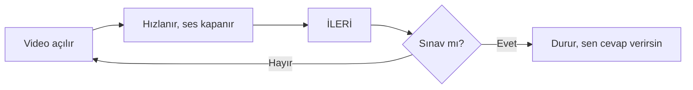
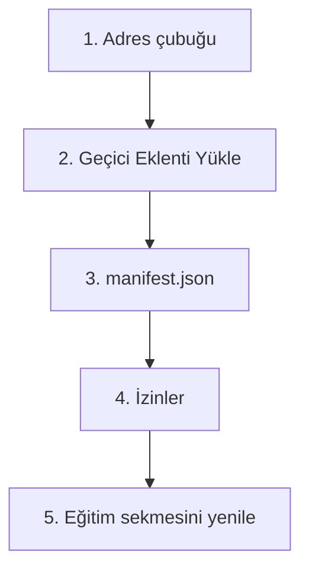
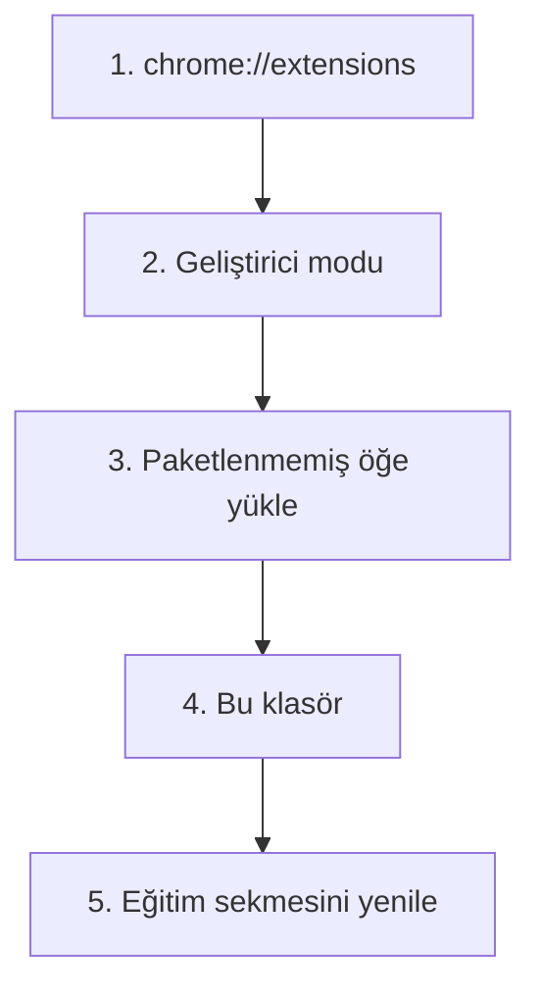
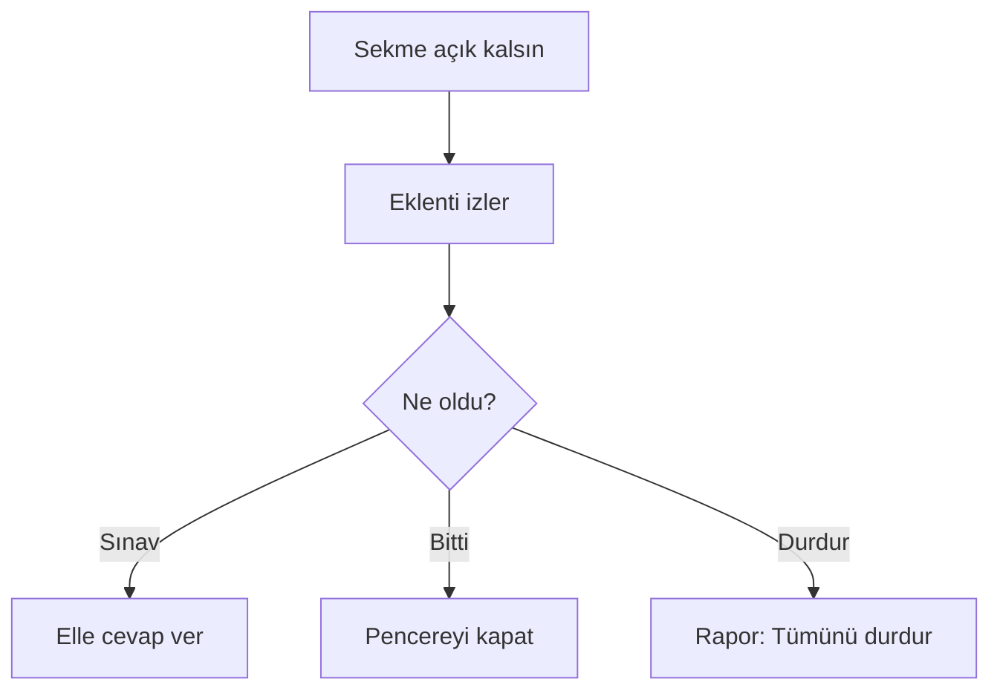
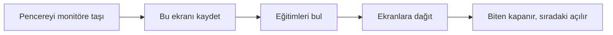

# egitimSavar

Uzaktan Eğitim Kapısı videolarını kendi kendine izler. **Firefox 128+** ve **Chrome**.

Video içi **Gönder** ve “izlemeye devam” ekranlarını da geçer. Gerçek sınavda durur. Simge ve rapor sayfası canlı durumu gösterir.

---

## Firefox’a yükle

Her oturumda bir kez. Firefox kapanınca geçici eklenti silinir.

| | Ne yap |
|---|---|
| **1** | Adres çubuğuna yapıştır: `about:debugging#/runtime/this-firefox` |
| **2** | **Geçici Eklenti Yükle…** |
| **3** | Bu klasördeki `manifest.json` dosyasını seç. Klasörün kendisini değil, dosyayı seç. |
| **4** | `about:addons` → egitimSavar → **İzinler** → site erişimi kapalıysa aç |
| **5** | Eğitim sekmesini yenile. Konsola kod yapıştırma. |

Simge → **Ayrıntılı raporu aç**.

Eski **UEK Otomatik İzleyici** yüklüyse kaldır. Kimlik değişti (`egitimsavar@local`); Firefox bunu ayrı eklenti sayar.

---

## Chrome’a yükle

Kalıcı kalır; tarayıcı kapanınca silinmez.

| | Ne yap |
|---|---|
| **1** | Adres çubuğuna yapıştır: `chrome://extensions` |
| **2** | Sağ üst: **Geliştirici modu** |
| **3** | **Paketlenmemiş öğe yükle** |
| **4** | Bu klasörü seç (`manifest.json` klasörün içinde olsun) |
| **5** | Site erişimi “Belirli sitelerde” veya “Tüm sitelerde” kalsın. Eğitim sekmesini yenile. |

Sekme arkadayken oynatmanın sürmesi yalnız Firefox’ta var. Chrome’da pencere önde kalsın.

---

## Günlük kullanım

- Durdurmak: simge → **Ayrıntılı raporu aç** → **Tümünü durdur**
- Sınav çıkınca eklenti bekler; cevap sende

---

## Birden fazla ekran

1. Firefox penceresini bir monitöre taşı → **Bu ekranı kaydet**. Diğer monitörler için tekrarla.
2. Katalog sekmesinde **Bu sayfadaki eğitimleri bul** (adres yapıştırmak da olur).
3. **Seçilenleri ekranlara dağıt.** Her kayıtlı ekranda bir pencere açılır; fazlası sıraya girer.
4. Eğitim bitince o pencereyi kapat. Sıradaki aynı yerde açılır.

Kayıtlı ekran yoksa bu monitörde en fazla 3 pencere açılır.

---

## Simge ne anlatır

| Rozet | Anlam |
|---|---|
| Yeşil sayı | Kaç pencere çalışıyor |
| Kırmızı `!` | Takıldı, bağlantı koptu veya son 5 dk’da hata |
| Turuncu `?` | Sınav, elle cevap bekliyor |
| Gri sayı | Yalnız sırada bekleyen var |

Fareyle üzerine gelince kısa özet çıkar. Ayrıntı için simgeye tıkla: durum kartı kendiliğinden yenilenir.

---

## Rapor

Simge → **Ayrıntılı raporu aç**.

| Bölüm | Ne var |
|---|---|
| Canlı takip | Oynatılıyor, sınav, takıldı, kapandı… Slayt, yüzde, hız, ses. Satıra tıklayınca zaman çizelgesi. |
| Olay günlüğü | Tüm pencereler. Seviye, pencere ve metne göre süzülür. |
| Kod inceleme | Bilinen hatalar ve sınırlar. “Doğruladım” işaretleri kalır. |

Düğmeler: **JSON dışa aktar**, **Raporu temizle**, **Tümünü durdur**.

Kayıt tarayıcıda durur: en çok 40 pencere, pencerede son 300 olay.

---

## Kalıcı Firefox paketi

Günlük iş için üstteki geçici yükleme yeter. Kalıcı istersen:

1. `npx web-ext build --source-dir .`
2. `web-ext-artifacts/` içindeki `.zip` adını `.xpi` yap
3. `about:addons` → dişli → **Dosyadan eklenti yükle…** → `.xpi`

Paket kökünde `manifest.json` olmalı. Üst klasörlü zip, “bozuk” der. İmzasız paket reddedilirse AMO’da imzalat veya Firefox Developer / ESR’de `xpinstall.signatures.required` kapat (yalnız bilinçli kullanım).

---

## Sürüm notları

v1.6.1 — arka planda oynatma

Sekme değişince videonun kendi kendini durdurması düzeltildi. `page-guard.js` sayfaya “görünür” der, blur olaylarını keser, gerçekten arkadayken gelen duraklatmaları yok sayar. Rapor, arka plan geçişlerini ve engellenen duraklatma sayısını gösterir. Ayrıntı: rapor → **Kod inceleme** → F16. **Firefox 128+** gerekir.

v1.6.0 — egitimSavar

Ad, simge, popup, rapor ve konsol etiketi `[egitimSavar]`. Video ortasındaki **Gönder** otomatik tıklanır; düğme kilitliyse önce bir seçenek işaretlenir. Ekran başına en çok 12 deneme; aşılırsa raporda “elle tıklayın” yazar. “Sınav” geçen formlara otomatik gönderilmez. Eski eklentiyi kaldır.

v1.5 — rapor ve simge

Canlı rapor, rozet, tooltip. Türkçe İLERİ/ÇIKIŞ eşleşmesi, ScormV2 modu, SweetAlert, Video.js sıradaki ders, izlemeden İLERİ, dağıtım sırası düzeltildi. Ayrıntı: rapor → **Kod inceleme**.

v1.4 ve öncesi

İLERİ yalnız açıkken basılır. Kilitliyken panel ve “devam” alanları tıklanır. Sıra Sizde: seçenek → Kontrol Et → Doğru Cevabı Gör. Aynı slaytta 3 dakika ilerleme yoksa zorunlu tık durur. SCORM hızı 4x. Ana Sayfa / çıkış tıklanmaz.

